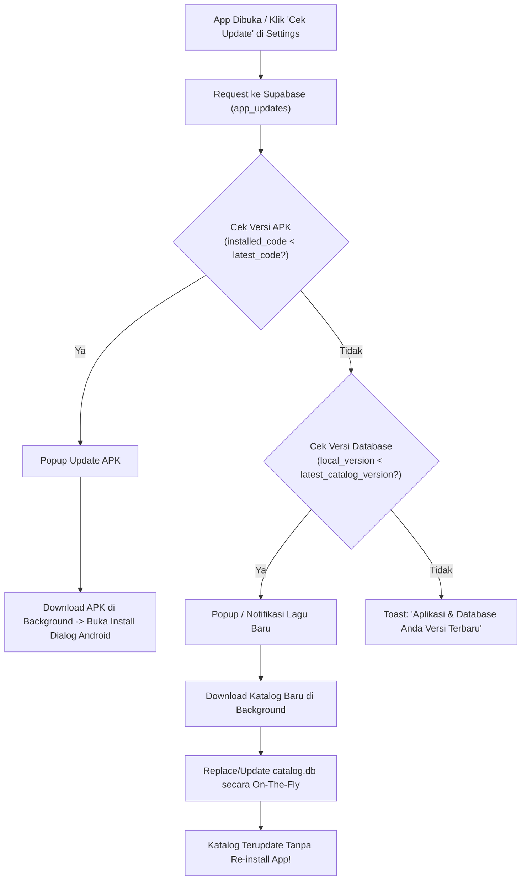

# Skema Update KordApp (Dual-Update Architecture)

Dokumen arsitektur untuk sistem pembaruan KordApp: **Update Aplikasi (APK)** dan **Update Database (Katalog Lagu)**.

---

## 1. Perbandingan Dua Tipe Update

| Aspek | 1. Update Aplikasi (APK) | 2. Update Database (Katalog) |
| :--- | :--- | :--- |
| **Tujuan** | Perbaikan bug UI, fitur baru, patch lisensi/security. | Penambahan ribuan lagu baru, perbaikan chord/lirik. |
| **Frekuensi** | Jarang (1-2 bulan sekali atau saat ada bug kritis). | Rutin (1-2 minggu sekali saat batch crawler selesai). |
| **Beban User** | Download file APK (~15-30 MB) & install manual via OS dialog. | Download background (~5-10 MB delta / 80 MB full XZ), tanpa install OS dialog. |
| **Dampak User** | Aplikasi restart. | Aplikasi tetap jalan, lagu langsung bertambah otomatis. |

---

## 2. Struktur Data di Supabase (`app_updates`)

Tabel tunggal di Supabase untuk mengontrol kedua jenis pembaruan:

```sql
CREATE TABLE app_updates (
    id SERIAL PRIMARY KEY,
    -- Info APK
    latest_app_version_code INT NOT NULL DEFAULT 1,
    latest_app_version_name TEXT NOT NULL DEFAULT '1.0.0',
    app_download_url TEXT,
    app_changelog TEXT,
    is_force_app_update BOOLEAN DEFAULT FALSE,

    -- Info Database
    latest_catalog_version INT NOT NULL DEFAULT 5,
    catalog_total_songs INT NOT NULL DEFAULT 157305,
    catalog_download_url TEXT, -- Link ke catalog_delta.json / catalog.db.xz
    catalog_checksum_sha256 TEXT,
    catalog_changelog TEXT,
    
    updated_at TIMESTAMPTZ DEFAULT NOW()
);
```

---

## 3. Alur Kerja Sistem (Workflow)



---

## 4. Rincian Teknis Implementasi

### A. Tipe 1: Update Aplikasi (APK)
1. **Pengecekan:** App membandingkan `BuildConfig.VERSION_CODE` dengan `latest_app_version_code`.
2. **Download:** Menggunakan `DownloadManager` Android ke folder internal/cache.
3. **Pemasangan:** Memanggil `FileProvider` dan Intent `ACTION_VIEW` (`application/vnd.android.package-archive`).
4. **Keamanan:** Signature APK rilis harus identik dengan APK yang terpasang agar tidak ditolak sistem Android.

### B. Tipe 2: Update Database (Katalog Lagu)
1. **Pengecekan:** Disimpan versi katalog saat ini di `SharedPreferences` (saat ini: versi 5).
2. **Download:** File `.xz` terkompresi (~80 MB) atau file diff batch JSON di-download di background via Coroutine.
3. **Swap Aman (Safe Replacement):**
   - Download ke file sementara: `catalog_new.db`.
   - Tutup koneksi Room `CatalogDatabase`.
   - Rename `catalog_new.db` menimpa `catalog.db`.
   - Buka kembali Room instance.
4. **Offline Resilience:** Jika download putus/gagal, file lama tetap aman digunakan tanpa merusak app.
